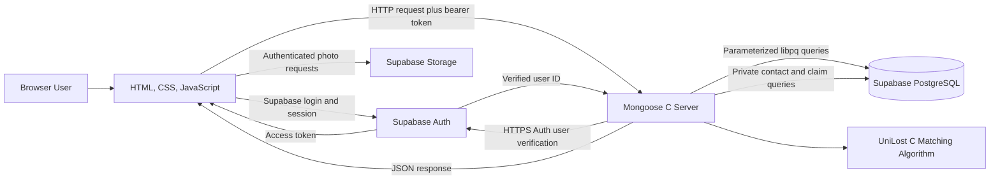
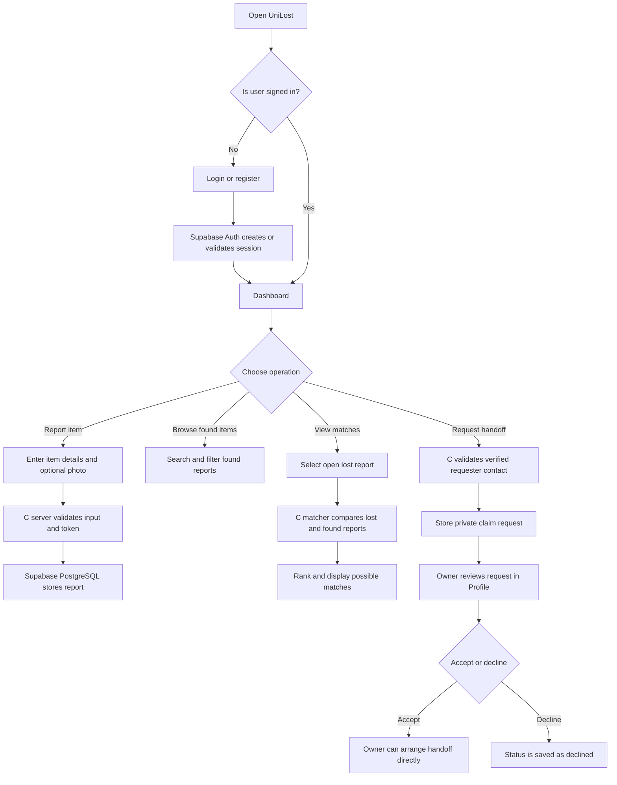

# UniLost - Campus Lost and Found System

## 1. Project Information

- Project title: UniLost - Campus Lost and Found System
- Course/subject: [Enter course name]
- Batch: [Enter batch]
- Evaluation: SEA Project
- Submission date: [Enter date]
- Project duration: [Enter duration]

## 2. Group Members

| Roll No. | Name | Role and Responsibilities |
|---|---|---|
| [Roll No.] | [Member 1 name] | Front-end pages and responsive interface |
| [Roll No.] | [Member 2 name] | C server routes and back-end logic |
| [Roll No.] | [Member 3 name] | Supabase database, SQL, and ownership design |
| [Roll No.] | [Member 4 name] | Authentication, matching, testing, and documentation |

## 3. Problem Definition

Students may lose personal items such as wallets, phones, notebooks, identification cards, and keys on a campus. Finding the owner is difficult because there is no centralized, secure place to report and search for items. Publicly sharing contact details creates privacy and spam risks.

UniLost is a campus lost-and-found web application that allows signed-in users to report lost or found items, browse found reports, receive ranked match suggestions, and make private handoff requests. Contact details are shared only with the verified owner of the relevant report.

## 4. Objectives

1. Provide separate pages for account access and lost-and-found operations.
2. Allow users to submit lost and found reports with item details and an optional photograph.
3. Store report and profile data in Supabase PostgreSQL.
4. Use Supabase Auth for registration, login, email or phone identity, password recovery, and session management.
5. Validate protected operations in the C HTTP server using a bearer access token.
6. Compare open lost reports with recent open found reports using a C matching algorithm.
7. Rank matches and explain category, name, description, location, and date scores.
8. Protect private contact information and handoff requests from unauthorized users.
9. Provide search, category, location, status, date, sorting, and pagination for found items.
10. Demonstrate a working application and basic automated tests during the SEA evaluation.

## 5. Scope

### Included features

- Account registration and login using email or phone.
- Forgot-password and reset-password flows.
- Lost and found item reporting.
- Optional found-item photo upload.
- Authenticated dashboard and personal report summaries.
- Browse-found-items search and filtering.
- C-ranked potential matches.
- User profiles and verified contact details.
- Private claim/handoff requests and owner inbox.
- Accept or decline handoff requests.
- Item status changes by the item owner.

### Limitations

- It is a localhost classroom prototype.
- It is single-threaded and should not be exposed to the public internet without additional security and scaling work.
- It has no CAPTCHA, moderation, campus SSO, rate limiting, or automated handoff notifications.
- Match scores are suggestions, not proof that an item belongs to a claimant.
- Email, SMS, and photo Storage behavior depend on the connected Supabase project configuration.

## 6. Target Users

- Students reporting a lost item.
- Students reporting an item they found.
- Item owners searching for possible matches.
- Campus users arranging a safe item handoff.

## 7. System Requirements

### Functional requirements

- Only signed-in users can create reports or access protected report, match, profile, and claim data.
- A user can create, view, and update only reports owned by that user.
- Search and filter options must return relevant found-item records.
- Item matches must be calculated for open lost reports.
- A report owner must decide whether to accept or decline each handoff request.

### Non-functional requirements

- Passwords are managed by Supabase Auth rather than stored by UniLost.
- Database operations use parameterized SQL.
- Public item responses omit private contact details.
- The interface should remain usable on desktop and mobile screens.
- Invalid input must receive clear validation errors.

### Development environment

- macOS
- Apple Clang and Make
- C11
- Mongoose 7.23 HTTP server
- libpq PostgreSQL client
- Supabase Auth and PostgreSQL
- HTML, CSS, and JavaScript
- Supabase JS ES module loaded through esm.sh

## 8. System Architecture



The browser never connects directly to the database. Protected API requests carry a Supabase access token. The C server sends the token to Supabase Auth for server-side verification and uses the returned authoritative user ID for ownership checks.

## 9. System Flow



## 10. Front-End Implementation

The front end is a multi-page HTML application with shared CSS and JavaScript.

| Page | Purpose |
|---|---|
| `index.html` | Authenticated dashboard |
| `login.html` | Email or phone login |
| `register.html` | Account registration |
| `forgot-password.html` | Password recovery request |
| `reset-password.html` | Set a new password |
| `report-item.html` | Report a lost or found item |
| `chat.html` | Send and receive private handoff messages |
| `reports.html` | Search and browse found-item reports |
| `profile.html` | Profile, owned reports, verified contacts, and handoff inbox |

Shared navigation contains exactly six entries: Home, Report Lost, Report Found, Chats, Browse Found Items, and Profile. The former `matches.html` URL redirects to `chat.html` for compatibility.

Older lost/found page URLs remain as protected compatibility redirects. Sign-out is available inside Profile rather than shared navigation.

## 11. Back-End Implementation

### C HTTP server

The Mongoose server receives HTTP requests and routes public and protected APIs. It verifies protected requests by sending the bearer token to the configured Supabase Auth `/auth/v1/user` endpoint.

### Database

Supabase PostgreSQL stores:

- Lost and found reports.
- Match records.
- Profile information.
- Auth ownership IDs.
- Private handoff claims.
- Optional photo paths.

The C server uses a dedicated PostgreSQL role and parameterized queries. The browser cannot directly modify database tables.

### Authentication

- Supabase Auth issues access tokens and manages passwords.
- C verifies every protected token server-side.
- C uses the verified Auth user ID, never a browser-supplied user ID, for ownership decisions.
- Missing or invalid tokens receive `401`.
- Supabase Auth or database outages receive `503`.

### Matching algorithm

For a single open lost report, C compares up to 200 recent open found reports and awards up to 100 points:

| Factor | Maximum score |
|---|---:|
| Exact normalized category | 30 |
| Item name overlap | 20 |
| Description overlap | 20 |
| Location overlap | 15 |
| Date proximity | 15 |

The algorithm:

1. Normalizes text to lower case and words.
2. Calculates Jaccard overlap for item name and description.
3. Adds category, location, and date factors.
4. Stores only scores of 40 or higher.
5. Sorts records by score using bubble sort.

Scores of 70–100 are labeled **Strong potential match**; scores of 40–69 are labeled **Possible match**.

## 12. Database Tables

### `items`

Stores report type, item name, category, description, location, date, status, owner ID, contact information, photo path, and creation time.

### `matches`

Stores one record for a lost/found item pair, match score, and creation time. Duplicate pairs are prevented by a unique index.

### `profiles`

Stores display name and verified contact information mirrored from Supabase Auth.

### `claims`

Stores private handoff requests, claimant contact details, message, status, and item ownership relationship.

## 13. Public and Protected API Examples

### Public examples

```sh
curl -i http://127.0.0.1:8000/api/health
curl -i http://127.0.0.1:8000/api/config
```

### Protected example

```sh
curl -i 'http://127.0.0.1:8000/api/items?type=found&search=wallet&category=Wallet&limit=18&offset=0' \
  -H 'Authorization: Bearer TEMP_ACCESS_TOKEN'
```

The complete API test set is in [API_TESTING.md](API_TESTING.md).

## 14. Sample Inputs and Outputs

### Sample registration input

- Display name: Test Student
- Email: test.student@example.invalid
- Phone: +919876543210
- Password: [sample password; not shared during demonstration]
- Initial login identity: Email or phone

### Sample lost-item input

- Report type: Lost
- Item name: Black leather wallet
- Category: Wallet
- Description: Small black wallet with a red student card
- Location: Central Library
- Date: 2026-10-20
- Optional photo: [No photo or fictional image]

### Expected result

The server validates the data and stores the report. The API returns success JSON and a report ID. The item appears under My Lost Items and in the signed-in user's lost report totals.

### Sample found-item input

- Report type: Found
- Item name: Black wallet
- Category: Wallet
- Description: Found wallet with a red student card
- Location: Library reading area
- Date: 2026-10-21

### Expected match output

| Lost report | Found report | Score | Label |
|---|---|---:|---|
| Black leather wallet | Black wallet | 85 | Strong potential match |

The match result should explain the category, name, description, location, and date factors. The actual score can differ with the real input.

### Sample filter input

```text
category = Wallet
search = black
location = library
status = open
sort = newest
limit = 18
offset = 0
```

### Expected filter output

- Only open found reports matching the selected filters.
- A maximum of 18 records on the page.
- Total count and `has_more` pagination information.

### Unauthorized update check

A second account attempts to update an item owned by the first account. The server returns a not-found or unauthorized ownership response, and no database status change occurs.

## 15. Testing

### Automated tests

Run:

```sh
make build
make test
```

Automated tests cover the C matcher and public-key safety checks. They do not require Supabase.

### Manual browser tests

1. Create and confirm a test account.
2. Sign in with the test account.
3. Submit a lost report.
4. Submit a matching found report with a second account.
5. Open Chats and verify the private handoff conversation.
6. Submit a private handoff request.
7. Open Profile with the owner account and view the requester's verified contact.
8. Accept or decline the request.
9. Filter and paginate found items.
10. Attempt an unauthorized status update and verify that it is denied.

### Security and hosted-flow checks

- Test email confirmation and password recovery.
- Test phone provider behavior only if configured.
- Verify private photo upload and download policies.
- Verify profile persistence.
- Test ownership with two separate accounts.
- Use non-sensitive fictional data only.

## 16. Working Demonstration Plan

1. Open the app at `http://127.0.0.1:8000`.
2. Demonstrate registration or login.
3. Show the dashboard totals.
4. Report a fictional lost item.
5. Browse found items and apply search/filter controls.
6. Report a fictional matching found item from a second test account.
7. Explain the C matching score factors: category, name, description, location, and date.
8. Submit a private handoff request.
9. Switch to the item owner's account and review the private request.
10. Accept or decline the request.
11. Demonstrate a forbidden cross-account update if time permits.

## 17. Results and Observations

[Insert one paragraph after testing: summarize successful features, test results, and hosted Supabase tests performed.] [Insert one limitation or issue observed during testing.] [Insert one future enhancement.]

## 18. Future Enhancements

- CAPTCHA and request rate limits.
- Automated email or SMS notifications.
- Moderation and reporting tools.
- Campus SSO integration.
- Image similarity matching.
- Map-based location and lost-item pickup zones.
- Clearer audit records for administrative actions.
- Deployment behind a production-ready web server.

## 19. Individual Contribution Record

| Member | Front end | Back end | Database/Auth | Matching/Testing | Presentation |
|---|---|---|---|---|---|
| [Member 1] | [Details] | [Details] | [Details] | [Details] | [Details] |
| [Member 2] | [Details] | [Details] | [Details] | [Details] | [Details] |
| [Member 3] | [Details] | [Details] | [Details] | [Details] | [Details] |
| [Member 4] | [Details] | [Details] | [Details] | [Details] | [Details] |

Replace all bracketed placeholders before submission. Each member must be able to explain and demonstrate the section assigned to them.

## 20. Viva Preparation

### Short explanation

“The frontend has separate pages for account access, reporting, browsing, matches, and profile management. Supabase Auth handles passwords and verification. The C server uses Mongoose to receive HTTP requests and libpq parameterized queries to store reports in PostgreSQL. For private actions, C asks Supabase Auth to validate the access token, then uses the verified account ID in owner-filtered SQL. The C matcher normalizes report text, scores category, name, description, location, and date, and bubble-sorts possible matches. A signed-in person can send a private handoff request; only the report owner can view the requester's verified contact in Profile.”

### Possible questions

1. Why should the browser not receive database credentials?
2. Why does C verify the access token through Supabase Auth instead of trusting JWT claims directly?
3. How are ownership checks enforced?
4. How does the matcher score an item?
5. What is Jaccard overlap?
6. Why can the score be a lead but not proof of ownership?
7. How are contact details kept private?
8. What do `401`, `400`, and `503` mean in this application?
9. How do parameterized queries reduce SQL injection risk?
10. What data is public, and what data is protected?
11. Why was C chosen for the server and matching logic?
12. What would need to change before public deployment?

## 21. Submission Checklist

- [ ] Group members and roll numbers entered.
- [ ] Individual responsibilities entered and verified.
- [ ] Project topic entered in the required Google Sheet.
- [ ] Problem definition and objectives completed.
- [ ] System architecture and flowchart reviewed.
- [ ] Front-end and back-end sections match the actual application.
- [ ] Sample inputs and outputs use fictional data.
- [ ] `make build` succeeds.
- [ ] `make test` succeeds.
- [ ] Supabase database migration setup is complete.
- [ ] Registration, login, and password recovery are tested.
- [ ] Two test accounts are used for ownership testing.
- [ ] Match demonstration is prepared.
- [ ] Private handoff request and inbox are prepared.
- [ ] Screenshots are copied into the presentation or appendix.
- [ ] Every member knows the viva explanation for their contribution.
