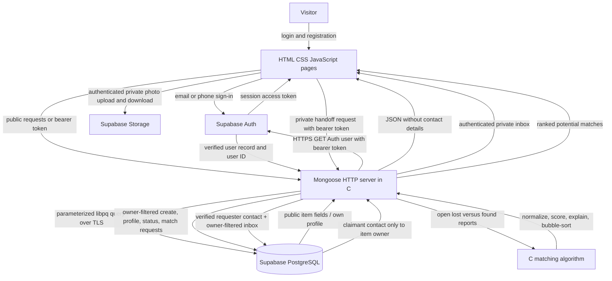

# UniLost system flow

For protected actions, the C server uses only the user ID returned by Supabase Auth after HTTPS token verification. The PostgreSQL connection stays in C and browser requests never include a caller-selected owner ID.
